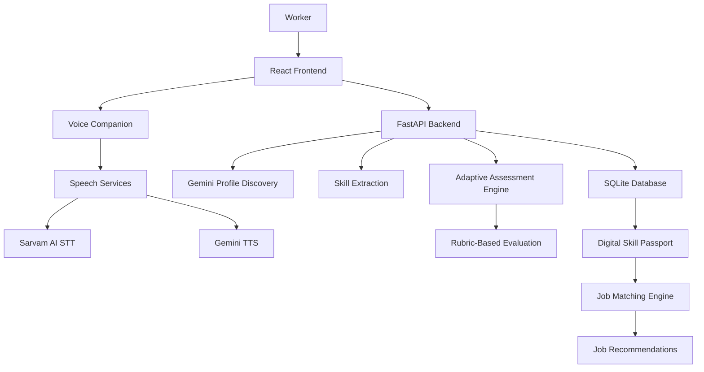

# Yogya 

**A voice-first skill discovery, assessment, and employment-readiness platform for India's informal workforce.**

[]()
[]()
[]()
[]()
[]()

---

## 🌟 The Problem

Millions of skilled workers in India possess valuable practical experience but lack formal certificates, documented qualifications, or the ability to create professional resumes.

Traditional recruitment systems often depend on written applications, educational credentials, and conventional hiring processes.

**The result? Skilled workers can remain invisible simply because they cannot formally prove what they know.**

Yogya addresses this gap by providing an accessible way for workers to communicate their experience, demonstrate their knowledge, build a structured record of their skills, and discover relevant employment opportunities.

## 💡 Our Solution

Yogya is a **voice-first AI-powered skill discovery and assessment platform** designed especially for workers who may have limited literacy or digital experience.

Instead of asking workers to create resumes or upload certificates, Yogya allows them to:

- Describe their work experience through voice.
- Communicate in their preferred supported language.
- Complete structured, trade-specific knowledge assessments.
- Build a digital Skill Passport.
- Understand their skill evidence and areas for improvement.
- Explore job opportunities based on their assessed skills.

**Our principle: Missing documentation does not mean missing ability.**

---

## 🎯 MVP Scope

The current MVP focuses on one end-to-end worker journey across two trades.

| Component | MVP implementation |
|---|---|
| Target users | Informal and skilled workers |
| Supported trades | Electrician and Plumber |
| Languages | Telugu, English and Hindi UI |
| Onboarding | Voice-based work experience discovery |
| Assessment | Adaptive, rubric-based questions |
| Skill Passport | Three-tier evidence classification |
| Job matching | Skill-based job recommendations |
| Accessibility | Voice guidance and simplified interactions |

## 🚀 Key Features

### 1. Voice-First Worker Onboarding

Workers can introduce themselves and describe their work experience without needing to prepare a resume.

- Voice recording and audio upload.
- Speech-to-text integration.
- Telugu, English and Hindi interface.
- AI-assisted extraction of structured skill information.
- Editable transcript before profile generation.
- Manual text input as an alternative.

### 2. Adaptive Skill Assessment

Workers complete structured assessments based on their selected trade.

- Separate question banks for Electricians and Plumbers.
- Six predefined questions per assessment.
- Foundational, intermediate and advanced difficulty levels.
- Adaptive progression based on assessment responses.
- Predefined evaluation rubrics.
- Structured feedback on submitted answers.
- Safety-related assessment flags.

**Evaluation approach:** AI assists with structured information processing, while assessment scoring follows predefined rubrics rather than unrestricted LLM-generated grading.

*Note: Knowledge assessment provides evidence of demonstrated understanding; it does not independently establish practical job-site competence.*

### 3. Digital Skill Passport

Every worker receives a structured record of their skills and available evidence.

The Skill Passport distinguishes three evidence levels:

| Evidence level | Meaning |
|---|---|
| Self-reported | Skills and experience declared by the worker |
| Assessed | Skills demonstrated through the structured assessment |
| Independently verified | Skills reviewed and confirmed through an independent verification process |

This distinction prevents unverified claims from being presented as confirmed competencies.

### 4. Intelligent Job Matching

Yogya connects worker skill profiles with relevant job requirements.

- Skill-based job recommendations.
- Job compatibility scores.
- Matched and missing skill information.
- Explanations for matching results.
- Suggestions for improving job readiness.

Job matching is intended to support informed decisions, not guarantee employment.

### 5. Skill Gap Identification

Yogya identifies areas where additional evidence or learning may be useful.

It distinguishes between:

- Skills reported by the worker.
- Skills demonstrated during assessment.
- Skills that have not yet been assessed.
- Skills requiring independent verification.

**Not assessed does not mean not skilled.**

---

## 🧠 Technology Stack

| Layer | Technologies |
|---|---|
| Frontend | React, Vite, JavaScript, CSS |
| Backend | Python, FastAPI |
| Database | SQLite |
| AI and language processing | Google Gemini API |
| Speech-to-text | Sarvam AI — Saaras v4 |
| Telugu text-to-speech | Gemini TTS |
| English and Hindi speech playback | Browser Speech Synthesis |
| Testing | Pytest, ESLint, Vite build |

### How AI is used

**Google Gemini**
- Extracts structured skill information from worker descriptions.
- Assists with profile discovery.
- Generates Telugu speech through the TTS integration.

**Sarvam AI**
- Converts recorded worker speech into text.
- Supports Telugu, English and Hindi transcription through the configured language codes.

**Deterministic Assessment Engine**
- Evaluates answers against predefined rubric criteria.
- Supports consistent scoring and structured feedback.
- Keeps assessment decisions separate from unrestricted generative AI grading.

---

## 🏗️ System Architecture



---

## 🔄 End-to-End Worker Journey

1. **Choose a language:** The worker selects Telugu, English or Hindi.
2. **Select a trade:** Electrician or Plumber.
3. **Describe experience:** The worker records or uploads their work description.
4. **Generate a profile:** Speech is transcribed and relevant skills are extracted.
5. **Complete assessment:** The worker answers structured trade-specific questions.
6. **Evaluate evidence:** Answers are assessed against predefined rubrics.
7. **Generate Skill Passport:** Worker information and evidence levels are organized.
8. **Explore opportunities:** Relevant job recommendations are displayed.

---

## 🛠️ Getting Started

### Prerequisites

- Python 3.10+
- Node.js and npm
- Git
- Google Gemini API key
- Sarvam AI API key

### 1. Clone the repository

```bash
git clone https://github.com/Lalitha-216/Yogya.git
cd Yogya
```

### 2. Backend Setup

```bash
cd backend

python -m venv .venv
```

Activate the virtual environment.

**Windows PowerShell:**

```powershell
.venv\Scripts\Activate.ps1
```

Install dependencies:

```bash
pip install -r requirements.txt
```

Create a `.env` file inside the `backend` directory:

```env
GEMINI_API_KEY=your_gemini_api_key
SARVAM_API_KEY=your_sarvam_api_key
GEMINI_MODEL=gemini-3.8-flash
```

Replace the placeholders with your actual API credentials.

Start the backend:

```bash
uvicorn main:app --reload --port 8000
```

Backend URL:

`http://127.0.0.1:8000`

### 3. Frontend Setup

Open a new terminal:

```bash
cd frontend
npm install
npm run dev
```

Frontend URL:

`http://localhost:5173`

### 4. Run Tests

Backend:

```bash
cd backend
python -m pytest -q
```

Frontend:

```bash
cd frontend
npm run build
npm run lint
```

---

## 🔐 Security

- API keys are stored in environment variables.
- Secret credentials must never be committed to GitHub.
- `.env` files should remain excluded through `.gitignore`.
- `.env.example` contains placeholders only.
- Provider errors should not expose secret credentials.

---

## ⚠️ Current MVP Limitations

Yogya is an MVP prototype, not a production-ready employment or certification system.

- Currently supports only Electrician and Plumber trades.
- Assessment is knowledge-based, not a practical job-site examination.
- Independent verification requires a qualified human verifier.
- Job listings are demonstration opportunities, not confirmed live vacancies.
- Speech recognition depends on external provider availability, API quotas and recording quality.
- Language translations and voice quality require further validation with native speakers.
- The current application requires internet connectivity for its cloud-based AI and speech services.

---

## 🔮 Future Scope

- Additional trades and occupational categories.
- Practical skill verification through qualified assessors.
- Offline-first worker onboarding.
- Expanded regional language support.
- Employer and assessor dashboards.
- Shareable, independently verifiable Skill Passports.
- Integration with verified employment opportunities.
- Improved accessibility for workers with limited digital literacy.

---

## 👩‍💻 Team

**Built by a six-member women-led team for HackWithAditya 2026.**

We believe that talent should not remain invisible because of missing certificates, limited literacy, or lack of access to technology.

## ❤️ Our Vision

> A worker should not need a certificate to begin proving what they can do.

**Yogya — Because skills deserve recognition.**


